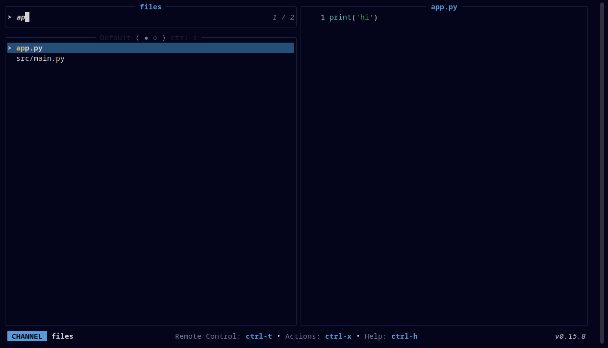

# Deepwick for television

Deepwick colors for [television](https://alexpasmantier.github.io/television/).

> Deepwick is an unofficial theme derived from
> [Polywick Blue](https://vscode.polywickstudio.net) by Polywick Studio (MIT).
> Not affiliated with Polywick Studio.



## Install

```sh
mkdir -p ~/.config/television/themes
cp deepwick.toml ~/.config/television/themes/
```

## Activate

In `~/.config/television/config.toml`, set `theme` under the existing `[ui]`
table (tv refuses to start if the file has two `[ui]` tables):

```toml
[ui]
theme = "deepwick"
```

## Previews

tv's built-in `files` and `text` channels force `BAT_THEME=ansi`. That draws
previews in your terminal's ANSI colors, which already looks right on a
Deepwick terminal theme. For full Deepwick syntax colors, install the
[Deepwick bat theme](https://github.com/deepwick/bat) and copy the channel
override:

```sh
mkdir -p ~/.config/television/cable
cp cable/files.toml ~/.config/television/cable/
```

## Notes

- Matches Gold, selected row on Selection, borders Overlay. The mode badges
  are Blue (channel), Teal (remote control) and Magenta (action picker).
- tv themes have no bold or italic.
- An unknown theme name falls back to tv's default without a warning.

Tested with television 0.15.9.

## License

MIT. See [LICENSE](LICENSE).
